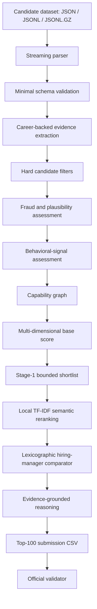

# Redrob Intelligent Candidate Discovery & Ranking System

An offline, explainable, adversarially robust candidate-ranking system built for the **Redrob Intelligent Candidate Discovery & Ranking Challenge**.

The system processes approximately **100,000 candidate profiles** and produces exactly **100 ranked candidates** for a Senior AI Engineer role. It is designed to behave more like an experienced engineering hiring manager than a keyword search engine: career-backed evidence, production ownership, integrity, capability depth, and behavioral readiness matter more than buzzword frequency.

> **Core idea:** trust evidence before measuring relevance.

## Table of Contents

- [Problem](#problem)
- [Why Simple Ranking Approaches Fail](#why-simple-ranking-approaches-fail)
- [Solution Overview](#solution-overview)
- [Architecture](#architecture)
- [How the Ranking Pipeline Works](#how-the-ranking-pipeline-works)
- [Evidence and Capability Model](#evidence-and-capability-model)
- [Fraud and Plausibility Detection](#fraud-and-plausibility-detection)
- [Behavioral Signals](#behavioral-signals)
- [Scoring and Final Comparison](#scoring-and-final-comparison)
- [Explainability](#explainability)
- [Performance Design](#performance-design)
- [Repository Structure](#repository-structure)
- [Installation](#installation)
- [Running the Ranker](#running-the-ranker)
- [Validating a Submission](#validating-a-submission)
- [Optional Preprocessing and Benchmarking](#optional-preprocessing-and-benchmarking)
- [Weighted Rank-Fusion Ensemble](#weighted-rank-fusion-ensemble)
- [Testing](#testing)
- [Observed Results](#observed-results)
- [Design Journey and Trade-offs](#design-journey-and-trade-offs)
- [Limitations and Future Improvements](#limitations-and-future-improvements)
- [Data and Privacy](#data-and-privacy)

## Problem

The challenge provides a large collection of structured candidate profiles and one job description. The objective is to return the **top 100 candidates**, in order, using the exact submission schema:

```text
candidate_id,rank,score,reasoning
```

This is not a conventional resume parsing or semantic-search task. The candidate pool intentionally contains difficult and adversarial profiles, including:

- keyword-stuffed profiles;
- unsupported AI or LLM claims;
- research-only candidates presented as production engineers;
- consulting-only profiles with little product ownership;
- behavioral twins with similar technical histories;
- impossible career or technology timelines;
- candidates who list every relevant tool without showing that they used any of them professionally.

The ranking system therefore needs to answer a harder question than “Which profile is textually similar to the job description?” It must answer:

> Which candidates have credible, recent, production-grade evidence that they can own retrieval, ranking, evaluation, and AI systems in a product environment?

## Why Simple Ranking Approaches Fail

### Keyword matching

A keyword matcher rewards repetition. A candidate who lists `RAG`, `FAISS`, `Pinecone`, `LangChain`, and `LLM` can outrank someone who actually shipped a retrieval system but described it using different terminology.

### Embedding-only retrieval

Embeddings measure semantic resemblance, not truth. A fabricated profile can be extremely similar to the job description. Semantic similarity also struggles to distinguish:

- production ownership from experimentation;
- professional work from courses or side projects;
- complete retrieval capabilities from isolated technology mentions;
- plausible experience from impossible claims.

### One large weighted score

A single flat score can allow one strong dimension to hide a critical weakness. For example, high semantic similarity should not compensate for unsupported claims or the absence of production evidence.

### Supervised learning without labels

Training a model such as XGBoost or LightGBM without trustworthy relevance labels would encode synthetic assumptions as if they were ground truth. This repository instead uses a transparent, deterministic ranking policy whose behavior can be inspected and changed directly.

## Solution Overview

The solution is a **cascading information-retrieval pipeline**. Cheap checks run first, expensive work runs only on survivors, and every stage preserves evidence for later explanation.

The main principles are:

1. **Evidence over claims** — career descriptions are trusted more than skill lists.
2. **Trust before relevance** — implausible profiles are penalized before semantic matching.
3. **Capabilities over products** — complete retrieval-system ability matters more than one named vector database.
4. **Production over buzzwords** — shipping, monitoring, scale, latency, evaluation, and ownership are strong signals.
5. **Behavior as a modifier** — availability and engagement improve confidence but cannot replace technical fit.
6. **Semantic similarity last** — local TF-IDF reranking contributes only after aggressive filtering.
7. **Explainability by construction** — final reasoning is generated from extracted profile evidence, not invented by a language model.
8. **Offline and CPU-first** — ranking uses the Python standard library and makes no network or hosted-model calls.

## Architecture



The cascade prevents expensive comparison work from being performed across the entire dataset. Candidate records are streamed rather than loaded into memory together.

## How the Ranking Pipeline Works

### 1. Streaming input

`redrob_ranker/data.py` supports:

- `.json` containing a list of candidates;
- `.jsonl` containing one candidate per line;
- `.jsonl.gz` for the compressed production dataset.

JSONL and compressed JSONL are processed incrementally, keeping memory usage bounded.

### 2. Minimal structural validation

Candidates must contain the key profile sections required by the pipeline:

- `candidate_id`;
- `profile`;
- `career_history`;
- `education`;
- `skills`;
- `redrob_signals`.

Profiles without a current title or usable career history are rejected early.

### 3. Evidence extraction

The system scans multiple independent sources:

| Evidence source | Relative trust | Why |
|---|---:|---|
| Career history | 1.00 | Strongest evidence of professional execution |
| Summary | 0.45 | Useful context, but self-authored |
| Skill assessment | 0.35 | Supporting signal, not proof of production ownership |
| Headline | 0.30 | Short and highly self-promotional |
| Skills list | 0.25 | Lowest-trust claim source |

Career evidence receives an additional production bonus when it contains signals such as deployment, scale, latency, monitoring, A/B testing, ownership, or maintained pipelines. Aspirational language such as “self learner,” “side project,” or “played with” reduces evidence strength.

### 4. Hard filtering

Cheap hard filters remove candidates who are clearly outside the target profile before detailed reranking. Current rules include:

- fewer than 3 years of experience;
- more than 15 years without sufficient production evidence;
- non-engineering titles without critical AI capabilities;
- extremely low capability coverage and production evidence.

Hard filters are intentionally conservative. Borderline profiles are usually retained and handled through penalties rather than silently discarded.

### 5. Fraud and plausibility assessment

Each survivor receives an integrity score and explicit fraud flags. Profiles with sufficiently severe combined penalties are removed. See [Fraud and Plausibility Detection](#fraud-and-plausibility-detection).

### 6. Behavioral assessment

Availability, recruiter engagement, profile trust, and location fit are calculated separately. Technical quality remains dominant.

### 7. Capability graph

Evidence is aggregated into engineering capabilities rather than counted as unrelated keywords. The graph measures overall coverage, critical capability coverage, and depth.

### 8. Base scoring

The ranker computes separate dimensions for integrity, capability match, production experience, retrieval strength, ranking/evaluation strength, experience fit, and behavior.

### 9. Bounded stage-one shortlist

The pipeline keeps at most 20,000 candidates after the cheap stage by periodically pruning the working list. This avoids retaining every plausible candidate until the end.

### 10. Local semantic reranking

Only the strongest 4,000 candidates enter semantic reranking. A local TF-IDF model with unigrams and bigrams compares career-backed candidate text with the job description. Skill-list text is deliberately excluded from this stage.

### 11. Final comparison and output

Candidates are sorted using a multi-dimensional comparison key, explanations are generated from evidence, scores are forced to be monotonically descending, and exactly 100 rows are written.

## Evidence and Capability Model

The system models eight capability groups defined in `redrob_ranker/taxonomy.py`:

| Capability | Examples of supporting evidence | Importance |
|---|---|---:|
| Retrieval systems | Information retrieval, semantic search, hybrid search, BM25, RAG, matching, recommendation | Critical |
| Ranking and evaluation | Reranking, learning-to-rank, NDCG, MRR, MAP, relevance judgments, A/B testing | Critical |
| Production ML | Serving, deployment, monitoring, drift, feature pipelines, inference | Critical |
| Vector infrastructure | ANN search, FAISS, HNSW, Pinecone, Qdrant, Milvus, OpenSearch | Critical |
| Python/backend | Python services, APIs, FastAPI, SQL, backend systems | Important |
| Product engineering | User metrics, feedback loops, experiments, recruiter/customer workflows | Important |
| LLM systems | LLMs, fine-tuning, LoRA/QLoRA, agents, transformers | Supporting |
| Data infrastructure | Spark, Airflow, Kafka, ETL, streaming, feature engineering | Supporting |

Capability strength is not a raw hit count. It depends on:

- the source where the evidence appears;
- capability-specific importance;
- the number of supporting phrases;
- whether the evidence is associated with production work;
- whether the language is professional or aspirational;
- support across multiple profile sections.

The capability graph calculates:

- **coverage** — weighted breadth across all capabilities;
- **critical coverage** — average strength in retrieval, vector infrastructure, ranking/evaluation, and production ML;
- **depth** — a combination of strong-capability count and critical coverage.

This allows a candidate with an end-to-end retrieval capability to outrank someone who merely lists several related technologies.

## Fraud and Plausibility Detection

`redrob_ranker/fraud.py` looks for adversarial or contradictory patterns. Current checks include:

### Unsupported expertise

- “Expert” skills with three months or less of experience;
- many AI skills that never appear in career history;
- AI-heavy claims attached to non-engineering roles;
- recent framework/demo experience without deeper retrieval evidence.

### Career consistency

- total role durations materially exceeding stated experience;
- multiple current roles;
- roles ending before they begin;
- future-dated career starts.

### Technology-release plausibility

Skill durations are compared with known public release periods. A claim that implies experience before a technology existed receives a penalty and an explanation flag.

### Professional context

- research-oriented profiles without production deployment evidence;
- consulting/services-only careers;
- side-project or self-learning AI profiles presented as professional experience.

Penalties accumulate into an integrity score:

```text
integrity = 1 - bounded_fraud_penalty
```

Candidates with a combined penalty of at least `0.72` are removed. Others remain rankable but carry an integrity disadvantage and, when relevant, a concern in their explanation.

## Behavioral Signals

Behavioral signals improve confidence in technically qualified candidates. They do not create technical qualification.

The behavioral model uses:

### Availability

- open-to-work flag;
- notice period;
- recent activity;
- recruiter response rate.

### Engagement

- recruiter response rate and response time;
- interview completion rate;
- profile views;
- recruiter saves;
- GitHub activity.

### Trust

- profile completeness;
- verified email and phone;
- LinkedIn connection;
- endorsements.

### Location fit

- preferred Indian hiring locations;
- relocation willingness;
- preferred work mode;
- India versus international location.

The behavioral score is:

```text
behavior =
    0.38 * availability
  + 0.28 * engagement
  + 0.20 * trust
  + 0.14 * location_fit
```

Behavior contributes only 8% of the pre-integrity base score, preventing responsiveness or availability from overpowering engineering evidence.

## Scoring and Final Comparison

The main base score is intentionally multi-dimensional:

```text
base_score =
    0.28 * capability_match
  + 0.20 * retrieval_strength
  + 0.16 * ranking_evaluation_strength
  + 0.15 * production_experience
  + 0.08 * experience_fit
  + 0.08 * behavior
  + 0.05 * integrity
```

The base is then adjusted for important gaps:

- weak retrieval capability;
- weak ranking/evaluation capability;
- consulting-only experience;
- aspirational AI claims without critical capability coverage.

Integrity is applied again as a multiplicative trust factor:

```text
final_before_semantic = base_score * (0.72 + 0.28 * integrity)
```

Semantic similarity is deliberately limited:

```text
final_score =
    0.92 * final_before_semantic
  + 0.08 * semantic_alignment * max(0.55, capability_match)
```

This design means semantic alignment can refine strong candidates but cannot rescue a weak or implausible profile.

### Hiring-manager style tie-breaking

The final comparator considers dimensions in this order:

1. final score;
2. integrity;
3. capability match;
4. production experience;
5. retrieval strength;
6. ranking/evaluation strength;
7. behavioral score;
8. candidate ID for deterministic ordering.

This preserves interpretable priorities instead of allowing arbitrary floating-point ties.

## Explainability

Every output row contains a reason generated by `redrob_ranker/explanation.py`.

The explanation generator:

- identifies the candidate's current role, company, and experience;
- selects the strongest career-backed capability evidence;
- quotes short snippets from the actual profile;
- notes production ownership and ranking/evaluation strength;
- includes relevant notice-period, location, recency, or fraud concerns;
- limits output length for a compact valid CSV.

No external LLM is called, and the generator does not invent evidence. If direct retrieval or ranking evidence is weak, it says so.

## Performance Design

The ranking pipeline is designed for CPU-only execution under challenge limits.

### Efficiency choices

- streaming JSONL/GZIP parsing;
- standard-library-only runtime;
- early structural and hard-fit rejection;
- cached phrase normalization;
- one normalization/tokenization pass per evidence block;
- bounded stage-one shortlist;
- semantic computation only for the strongest 4,000 candidates;
- local sparse TF-IDF instead of neural embeddings;
- no network calls, model downloads, GPU, or vector database.

### Memory behavior

The raw 100,000-record dataset is never loaded as one Python list. Only surviving candidate evaluations are retained, and the working shortlist is periodically pruned.

## Repository Structure

```text
.
├── rank.py                         # Main executable entry point
├── config/
│   └── default.json                # Human-readable default settings
├── redrob_ranker/
│   ├── behavior.py                 # Availability, engagement, trust, location
│   ├── capability_graph.py         # Capability coverage and depth
│   ├── cli.py                      # Command-line interface
│   ├── comparator.py               # Deterministic final comparison
│   ├── config.py                   # Runtime RankerConfig dataclass
│   ├── data.py                     # Streaming loaders and validation
│   ├── evidence.py                 # Multi-source evidence extraction
│   ├── explanation.py              # Grounded reasoning generation
│   ├── fraud.py                    # Fraud and plausibility checks
│   ├── jd.py                       # Target job profile
│   ├── pipeline.py                 # End-to-end cascade orchestration
│   ├── scoring.py                  # Multi-dimensional scoring
│   ├── semantic.py                 # Local TF-IDF semantic reranker
│   ├── submission.py               # Validator-compatible CSV writer
│   ├── taxonomy.py                 # Capabilities, phrases, release dates
│   └── text.py                     # Normalization and similarity utilities
├── scripts/
│   ├── benchmark.py                # Runtime benchmark
│   ├── ensemble_submissions.py     # Optional weighted rank fusion
│   └── preprocess.py               # Explainable feature export
├── tests/                          # Unit and integration tests
├── outputs/                        # Generated artifacts; CSV/JSON ignored
├── pyproject.toml
├── requirements.txt
└── submission_metadata.yaml
```

`RankerConfig` and CLI arguments are the runtime configuration source. `config/default.json` documents the principal defaults but is not automatically loaded by the current CLI.

## Installation

### Requirements

- Python 3.11 or newer;
- no GPU;
- no network access during ranking.

### Setup

```bash
git clone https://github.com/YOUR_USERNAME/YOUR_REPOSITORY.git
cd YOUR_REPOSITORY

python -m venv .venv
source .venv/bin/activate
python -m pip install --upgrade pip
pip install -r requirements.txt
```

The runtime ranker itself uses only the Python standard library. `pytest` is included for development and validation.

## Running the Ranker

Place the challenge dataset outside version control, for example:

```text
data/candidates.jsonl.gz
```

Run the full pipeline:

```bash
python rank.py \
  --candidates ./data/candidates.jsonl.gz \
  --out ./outputs/submission.csv
```

Supported inputs:

```bash
python rank.py --candidates ./data/candidates.json     --out ./outputs/submission.csv
python rank.py --candidates ./data/candidates.jsonl   --out ./outputs/submission.csv
python rank.py --candidates ./data/candidates.jsonl.gz --out ./outputs/submission.csv
```

### Useful runtime options

```text
--top-k          Number of output candidates; official value is 100
--stage1-keep    Survivors retained before semantic reranking; default 20000
--semantic-keep  Candidates receiving semantic reranking; default 4000
--validate-with  Path to the official validator
--log-level      DEBUG, INFO, WARNING, or ERROR
```

For a small sample containing fewer than 100 candidates, reduce `--top-k`:

```bash
python rank.py \
  --candidates ./data/sample_candidates.json \
  --out ./outputs/sample_ranking.csv \
  --top-k 10
```

## Validating a Submission

The safest workflow runs ranking and validation in one command:

```bash
python rank.py \
  --candidates ./data/candidates.jsonl.gz \
  --out ./outputs/submission.csv \
  --validate-with ./challenge_files/validate_submission.py
```

Or run the official validator separately:

```bash
python ./challenge_files/validate_submission.py ./outputs/submission.csv
```

A valid official submission has:

- exactly the header `candidate_id,rank,score,reasoning`;
- exactly 100 non-empty data rows;
- unique candidate IDs;
- ranks 1 through 100 exactly once;
- non-increasing numeric scores;
- deterministic candidate-ID ordering for equal scores.

`redrob_ranker/submission.py` prevents score-order failures by forcing scores to decrease by at least the configured output precision unit.

## Optional Preprocessing and Benchmarking

### Explainable feature export

Preprocessing is not required for ranking. It is available for inspection, debugging, and analysis:

```bash
python scripts/preprocess.py \
  --candidates ./data/candidates.jsonl.gz \
  --out ./outputs/features.jsonl
```

Each JSONL row contains capability scores, production score, behavioral score, integrity, and fraud flags.

### Benchmark

```bash
python scripts/benchmark.py \
  --candidates ./data/candidates.jsonl.gz
```

The command reports elapsed time, retained candidate count, and the top candidate ID and score.

## Weighted Rank-Fusion Ensemble

The repository also contains an optional post-processing ensemble for combining three already valid Redrob submissions.

Raw score averaging is intentionally avoided because different systems may produce scores on incomparable scales. Instead, the ensemble uses weighted ranks:

```text
fused_rank =
    0.50 * rank_ravi
  + 0.30 * rank_ujjwal
  + 0.20 * rank_ritu
```

If a candidate is absent from a submission, that source assigns rank `150`. Lower fused rank is better. The top 100 candidates receive new ranks 1–100 and monotonic scores:

```text
score = 1 - ((final_rank - 1) / 100)
```

The higher Ravi weight was selected because its top candidates showed the strongest cross-submission support and its reasoning contained the most specific production evidence. These weights are a strategic heuristic, not a claim of ground-truth superiority.

Run the ensemble:

```bash
python scripts/ensemble_submissions.py \
  --ravi ./submissions/submission_ravi.csv \
  --ujjwal ./submissions/submission_ujjwal.csv \
  --ritu ./submissions/submission_ritu.csv \
  --output ./outputs/ensemble_submission.csv \
  --report ./outputs/ensemble_analysis.md \
  --analysis-json ./outputs/ensemble_analysis.json
```

The ensemble additionally:

- reports pairwise and three-way overlap;
- shows the final top 20;
- identifies candidates introduced or dropped relative to Ravi;
- flags risky additions such as single-source candidates, high notice periods, low response rates, stale activity, or plausibility concerns;
- selects the strongest available reasoning and merges non-duplicative concerns.

## Testing

Run all tests:

```bash
pytest
```

The test suite covers:

- career-backed retrieval and ranking evidence;
- penalties for unsupported keyword stuffing;
- behavior rewards for responsive and available candidates;
- end-to-end pipeline ordering;
- required submission columns and reasoning.

## Observed Results

On the full 100,000-candidate dataset used during development, one local CPU run produced:

| Metric | Observed value |
|---|---:|
| Parsed candidates | 100,000 |
| Retained after hard filters | 31,099 |
| Rejected before final stages | 68,901 |
| Output candidates | 100 |
| End-to-end wall time | 198.93 seconds |
| Official validator | Passed |

These figures are environment-specific and should not be treated as a universal benchmark. Hardware, Python version, filesystem speed, and dataset path can change runtime.

For the three-submission Ravi-anchored ensemble used during development:

| Metric | Value |
|---|---:|
| Unique candidates across submissions | 203 |
| Present in all three submissions | 18 |
| Finalists present in all three | 18 |
| Finalists present in exactly two | 57 |
| Finalists present in one | 25 |
| Official validator | Passed |

No challenge dataset or private candidate profile is required to be committed to reproduce the code structure and tests.

## Design Journey and Trade-offs

The solution evolved through several deliberate decisions.

### 1. Start from the adversarial threat model

The dataset description made it clear that relevance alone was insufficient. The architecture therefore begins with schema quality, engineering plausibility, and evidence credibility rather than embeddings.

### 2. Establish an evidence hierarchy

Career descriptions became the primary source of truth. Summaries, headlines, assessments, and skills remain useful, but their lower source weights prevent self-authored claims from dominating professional evidence.

### 3. Replace technology matching with capability matching

Individual tools were grouped into capabilities. This lets FAISS, Pinecone, Qdrant, OpenSearch, and HNSW contribute to vector-infrastructure evidence without making any single vendor mandatory.

### 4. Separate trust from fit

Fraud penalties and integrity are calculated separately from job relevance. This prevents a highly relevant but implausible profile from ranking as if it were trustworthy.

### 5. Use a cascade for scale

Running semantic comparison and detailed ranking on all 100,000 profiles was unnecessary. Streaming, hard filters, bounded retention, and a semantic shortlist reduced compute while preserving strong candidates.

### 6. Keep semantics subordinate

Semantic matching was retained because wording varies across companies and industries. Its contribution was capped at 8%, and it runs without skills-section text, so it improves recall without becoming the ranking engine.

### 7. Generate explanations from the same evidence used for scoring

The explanation layer does not reinterpret raw profiles independently. It consumes the evidence, behavioral assessment, and fraud flags already used in ranking, reducing contradictions between score and reasoning.

### 8. Add rank fusion only after independent rankings existed

When three valid submissions became available, weighted rank fusion was chosen instead of score averaging. Rank fusion is robust to different score distributions and exposes consensus, disagreement, and single-source risk.

## Limitations and Future Improvements

This is a strong deterministic baseline, not a learned hiring oracle.

### Current limitations

- capability phrases and weights are manually designed;
- the default job profile is represented in code rather than parsed dynamically from arbitrary documents;
- technology release dates require maintenance;
- phrase-based evidence extraction can miss unusual terminology;
- fraud rules detect suspicious patterns but cannot prove deception;
- there are no labeled relevance judgments for calibrated offline evaluation;
- `config/default.json` is descriptive and is not currently loaded by the CLI;
- ensemble source names and weights are currently fixed in the script.

### High-value next steps

- add a generic job-description parser that produces a `JobProfile`;
- move taxonomy, fraud thresholds, and score weights into versioned configuration;
- add temporal decay for older career evidence;
- detect overlapping employment intervals more precisely;
- create ablation reports showing the effect of fraud, behavior, semantic reranking, and each capability;
- add NDCG/MRR evaluation when human relevance labels become available;
- support configurable rank-fusion sources and weights;
- add structured explanation objects before rendering final text;
- package a reproducible benchmark harness with CPU and memory telemetry.

## Data and Privacy

Candidate datasets and generated submission CSVs may contain challenge-controlled or sensitive information. They should not be pushed to a public repository unless the challenge rules explicitly permit it.

The included `.gitignore` excludes generated CSV, JSON, JSONL, cache, virtual-environment, and macOS metadata files. Before pushing, always inspect staged files:

```bash
git status
git diff --cached
```

Recommended public repository contents are the source code, tests, configuration examples, metadata template, and this README—not the private candidate dataset.

🙌 Acknowledgments:

Built as part of the Redrob Intelligent Candidate Discovery & Ranking Challenge, this project explores how explainable algorithms can improve candidate discovery while resisting keyword stuffing, unsupported claims, and misleading profiles.
---

This project favors a deliberately unglamorous idea: a trustworthy ranking system should first establish **what the candidate actually did**, then decide how closely that evidence matches the role.
